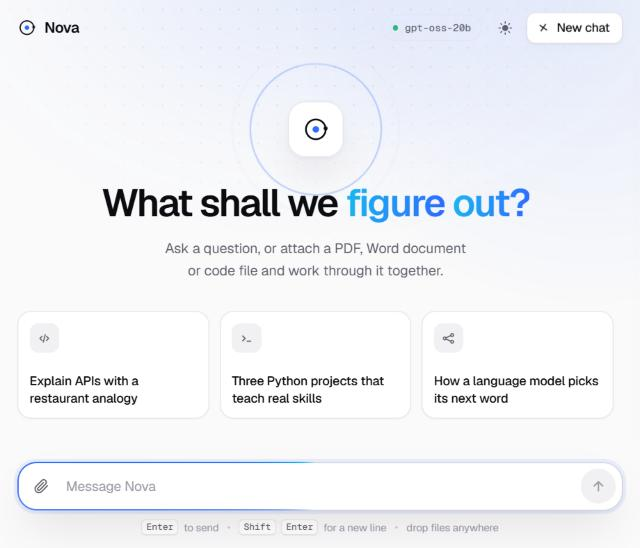
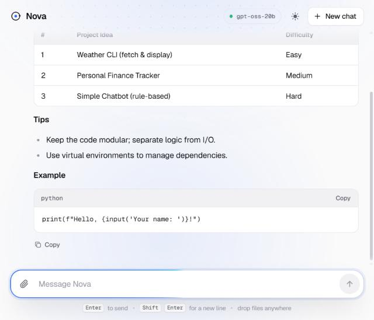
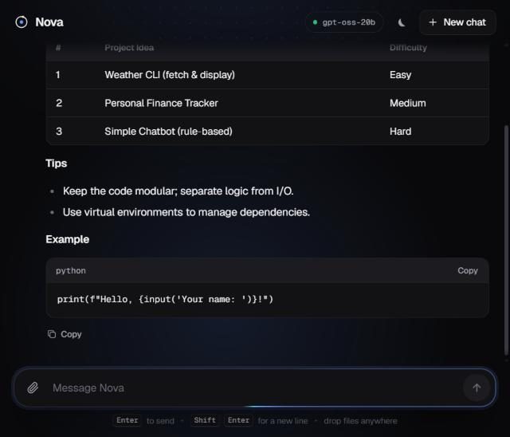

# Nova

**An AI chat assistant that streams its answers and can read your documents.**
Built by Vishnu Teja while learning AI engineering, from a first API call to a deployable web app.



## Features

- **Multi-agent team for any task.** A Planner splits substantial requests between an Analyst (live data and exact calculations via tool calling) and a Researcher (RAG over a knowledge library and your documents) working in parallel; a Writer produces the answer, report, plan or code, and a Reviewer checks it. Free-tier Groq models only. See [nova-web/README.md](nova-web/README.md) and the [learning guide](docs/guides/nova-agents-learning-guide.pdf).
- **RAG over your documents.** Add annual reports or notes to the Library; Nova searches them with hybrid BM25 + vector search and cites the exact passage.
- **Streaming replies.** Answers appear word by word as the model writes them, with a Stop button.
- **Conversation memory.** Nova remembers earlier messages in the same chat.
- **Read your files.** Attach PDFs, Word documents, text, CSV or code files with a button, drag and drop, or paste, then ask questions about them.
- **Rich answers.** Tables, lists, code blocks with a copy button, and links are rendered properly.
- **Light and dark themes.** Follows your system setting, or switch by hand.
- **Built for safety.** The API key never reaches the browser, visitors can't rewrite Nova's instructions, uploads are size-checked, and an optional access code keeps the site private.

| Light | Dark |
| --- | --- |
|  |  |

## How it works

```
Browser (static/)                 FastAPI server (app.py)              Groq
──────────────────                ───────────────────────              ────
keeps the whole chat   ── POST /api/chat ──►  adds the system prompt  ──►  open-source
sends it every turn                             streams the reply      ◄──  language model
shows words as they arrive  ◄── text stream ──

PDF / Word file        ── POST /api/extract ─►  pypdf / docx reader
                       ◄── plain text ───────
```

Language models don't remember anything between requests, and neither does a serverless function.
So the browser keeps the conversation and sends all of it with every message.
Attached files are turned into text and placed inside the message, wrapped in `<file name="...">` tags.

## Tech stack

| Part | Tools |
| --- | --- |
| Model | `openai/gpt-oss-20b` on [Groq](https://groq.com) |
| Backend | Python, FastAPI, Groq SDK, pypdf |
| Frontend | Plain HTML, CSS and JavaScript (no framework), Geist font |
| Hosting | Ready for Vercel (`vercel.json` included) |

## Project structure

```
nova-web/        the web app
├── app.py       backend: /api/chat (streaming), /api/extract (files), /api/health
└── static/      frontend: index.html, style.css, app.js
chatbot/         the command-line version, built step by step
├── hello.py     step 1: a single API call
├── chatbot.py   steps 2-3: chat loop with memory and streaming
└── gemini/      the same first steps using Google's Gemini API
```

## Run it locally

You need Python 3.11+ and a free API key from [console.groq.com/keys](https://console.groq.com/keys).

```bash
cd nova-web
python -m venv .venv
.venv\Scripts\activate          # macOS/Linux: source .venv/bin/activate
pip install -r requirements.txt uvicorn
copy .env.example .env          # macOS/Linux: cp .env.example .env
```

Put your key in `.env` after `GROQ_API_KEY=`, then start the server:

```bash
uvicorn app:app --reload --port 8000
```

Open http://localhost:8000.

## Deploy to Vercel

```bash
cd nova-web
npx vercel@latest
npx vercel@latest env add GROQ_API_KEY
npx vercel@latest env add ACCESS_CODE
npx vercel@latest --prod
```

Setting an `ACCESS_CODE` is strongly recommended: without it, anyone who finds the URL can use your Groq quota.
See [nova-web/README.md](nova-web/README.md) for details.

## What I learned

- How LLM APIs work: messages and roles, tokens, temperature, and why models are stateless
- Streaming responses from the model, through the server, to the browser
- Handling real errors: rate limits, invalid keys, and a free tier with a quota of zero
- Turning PDFs and Word files into text a model can read
- Keeping secrets out of code and out of git
- Designing an interface that feels fast and polished

## More projects in this repo

- **[Ask My Docs (rag/)](rag/README.md):** question answering over your own documents with cited answers. Hybrid search (BM25 + embeddings), a cross-encoder reranker and a retrieval evaluation (Hit@4 100%, MRR 1.00 on 18 test questions). Learning guide: [docs/guides/rag-learning-guide.pdf](docs/guides/rag-learning-guide.pdf).

## Author

**Vishnu Teja** · [GitHub @vishnuteja778](https://github.com/vishnuteja778)
