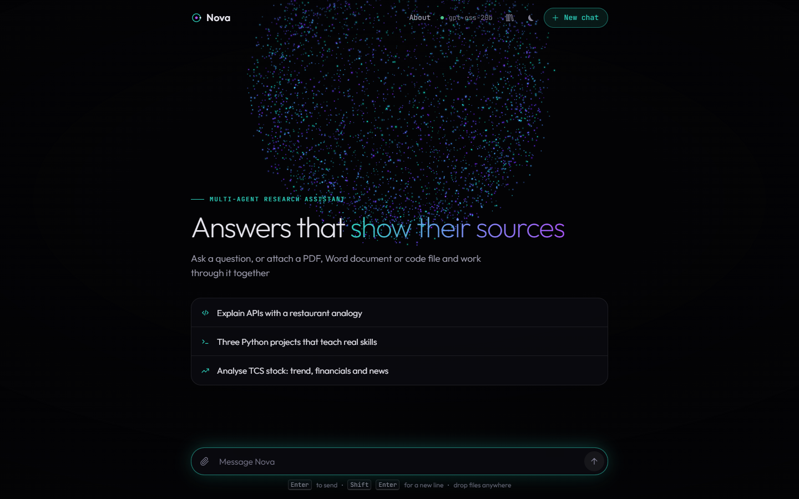
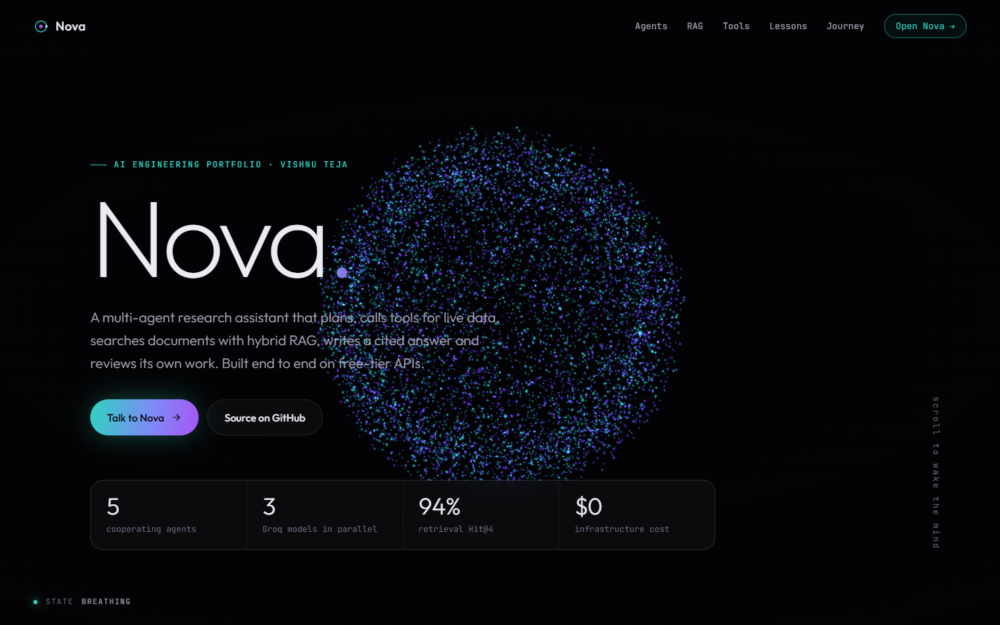

# Nova

**A multi-agent research assistant that plans, calls tools for live data, searches your documents with hybrid RAG, writes a cited answer and reviews its own work. Built end to end on free-tier APIs.**

Built by Vishnu Teja while learning AI engineering, from a first API call to a five-agent system.



| | |
| --- | --- |
| **5** cooperating agents | **3** Groq models in parallel |
| **94%** retrieval Hit@4 (hybrid search) | **$0** infrastructure cost |

## What it does

- **Answers that show their sources.** Every claim from a document is cited as `D1`, `D2`; every fetched number as `Live data`. A Sources list names the exact file and section.
- **A team for substantial tasks.** A Planner decides who works on each request: an **Analyst** (live data, exact calculations) and a **Researcher** (your documents) work in parallel, a **Writer** produces the answer, report, plan or code, and a **Reviewer** checks it and can force one rewrite.
- **You watch it work.** A numbered work log streams every step ("Analyst → calculating 12000 × 12", "Reviewer: approved") and folds into one line when the answer lands.
- **RAG over your documents.** Add annual reports, notes or manuals to the Library. Long attachments are indexed automatically instead of being cut off.
- **Live market data.** Quotes, technicals, three years of financials and news for any listed company (NSE, BSE, US).
- **Quick replies stay quick.** Greetings and simple questions skip the team entirely.

## Portfolio page

Nova has its own landing page at **`/about/`**: a Three.js particle "mind" that breathes, opens into a galaxy and gathers into a neural brain as you scroll, alongside the full technical story.



## How it works

```
request ─► PLANNER ── "direct" ──► single Nova (quick replies, streaming)
              │ "team"
              ▼
   ANALYST                          RESEARCHER                  ◄ in parallel, only if needed
   calculator, market data, web     hybrid RAG over the library
              │                     and your uploaded documents
              └──────────── short notes ───────────┘
                               ▼
                 WRITER  ──► cited draft, streamed to the browser
                               ▼
                 REVIEWER ─► approve, or one revision that replaces the draft
```

| Agent | Groq model | Role |
| --- | --- | --- |
| Planner | `qwen/qwen3.8-27b` | Reply directly, or assemble a team (JSON decision) |
| Analyst | `openai/gpt-oss-120b` | `calculate`, `analyze_stock`, quote, history, financials, news, optional `web_search` |
| Researcher | `qwen/qwen3.8-27b` | `search_documents`: BM25 + vector search fused with Reciprocal Rank Fusion |
| Writer | `openai/gpt-oss-20b` | Streams the final answer with citations |
| Reviewer | `openai/gpt-oss-120b` | Checks facts, maths, code and citations (JSON verdict) |

**Why three models?** Groq's free tier gives each model its own ~8,000 tokens-per-minute budget. A team run uses 10–15k tokens, so spreading agents across three models lets it fit the free tier.

### RAG

```
document ─► section-aware chunks (800 chars, 150 overlap)
         ─► BGE-small embeddings (384 dims, local, no API key)
         ─► int8 quantised vectors (4× smaller)

query ─► BM25 ranking ─┐
      ─► vector ranking ┴─► RRF  Σ 1/(60 + rank) ─► top 4 passages ─► D1…D4
```

Serverless functions have no disk, so uploaded documents are indexed by `/api/library`, stored in the browser and sent back with each chat. The built-in knowledge library is indexed once by `build_index.py`.

### Results

Retrieval on 16 labelled questions (`python eval_rag.py`):

| Method | Hit@4 | MRR |
| --- | --- | --- |
| BM25 only | 88% | 0.73 |
| Vector only | 88% | 0.81 |
| **Hybrid (RRF)** | **94%** | 0.77 |

The standalone [Ask My Docs](rag/README.md) project adds a cross-encoder reranker: **100% Hit@4, MRR 1.00** on 18 questions.

End-to-end timings on the free tier: greeting 0.7 s · code task 1.7 s · savings calculation 4.1 s · stock analysis 9.3 s · two-bank comparison 19 s.

## Engineering problems solved

| Problem | Cause | Fix |
| --- | --- | --- |
| Empty replies after tool calls | gpt-oss lost its reasoning between turns | Pass the reasoning back with the tool calls |
| Instant 429s with no usage | Groq reserves `max_tokens` against the per-minute budget up front | Explicit per-agent `max_tokens` |
| A crashed agent lost its data (72 s, failed) | The model called a tool after being told not to | Notes fallback so fetched data is never lost (**19 s, complete**) |
| Over-eager Researcher (37 s) | Searched 7 times for data the library doesn't hold | Stopping rule plus a hard cap in code (**9.3 s**) |
| Reviewer JSON failed | Hidden reasoning used the whole token allowance | Low reasoning effort for JSON agents; a failed review is skipped, not fatal |
| Broken citations | Models wrote `【D1】` and hid zero-width spaces | Normalise the stream in code |

## Security

- Per-IP rate limits (20 messages, 10 uploads per minute) and a 15-minute lockout after 5 wrong access codes, compared with `secrets.compare_digest`
- Model output is HTML-escaped before Markdown rendering; visitors can't send `system` messages
- A safe calculator built on Python's `ast` (no `eval()`), ticker validation, 4 MB uploads, zip-bomb checks, Pydantic size limits
- The API key never reaches the browser or git

## Tech stack

| Part | Tools |
| --- | --- |
| Models | Groq: `gpt-oss-120b`, `gpt-oss-20b`, `qwen3.8-27b` |
| Backend | Python, FastAPI, Pydantic, Groq SDK |
| RAG | fastembed (BGE-small), BM25 from scratch, Reciprocal Rank Fusion, NumPy |
| Tools | yfinance, a safe AST calculator, optional Tavily web search |
| Frontend | Plain HTML, CSS and JavaScript, Three.js for the particle orb, Outfit and JetBrains Mono |
| Hosting | Vercel (serverless Python + static files) |

## Project structure

```
nova-web/              the web app
├── app.py             FastAPI routes: /api/chat, /api/library, /api/extract, /api/health
├── agents.py          Planner, Analyst, Researcher, Writer, Reviewer; safe calculator
├── stock_tools.py     market-data tools (Yahoo Finance)
├── rag.py             chunking, BM25, embeddings, hybrid search
├── build_index.py     indexes knowledge/ into knowledge_index.json
├── eval_rag.py        retrieval evaluation (Hit@4, MRR)
├── knowledge/         the built-in knowledge library
└── static/            chat UI (index.html, style.css, app.js, orb.js) and about/ landing page
rag/                   Ask My Docs: standalone RAG with reranking and evals
chatbot/               the command-line version, built step by step
docs/guides/           PDF learning guides for each project
```

## Run it locally

You need Python 3.11+ and a free API key from [console.groq.com/keys](https://console.groq.com/keys).

```bash
cd nova-web
python -m venv .venv
.venv\Scripts\activate          # macOS/Linux: source .venv/bin/activate
pip install -r requirements.txt uvicorn
copy .env.example .env          # macOS/Linux: cp .env.example .env
```

Put your key in `.env` after `GROQ_API_KEY=`, then start the server:

```bash
uvicorn app:app --reload --port 8000
```

Open http://localhost:8000 for the chat and http://localhost:8000/about/ for the landing page.

## Deploy to Vercel

```bash
cd nova-web
npx vercel@latest
npx vercel@latest env add GROQ_API_KEY
npx vercel@latest env add ACCESS_CODE
npx vercel@latest --prod
```

Setting an `ACCESS_CODE` is strongly recommended: without it, anyone who finds the URL can use your Groq quota. See [nova-web/README.md](nova-web/README.md) for every setting.

## Learning guides

Each project comes with a PDF that explains the concepts, the code and the bugs:

- [Nova Agents: tool calling, RAG and a multi-agent team](docs/guides/nova-agents-learning-guide.pdf)
- [Ask My Docs: a RAG learning guide](docs/guides/rag-learning-guide.pdf)

## Author

**Vishnu Teja** · [GitHub @vishnuteja778](https://github.com/vishnuteja778)

*Stock analysis in Nova is research, not financial advice.*
